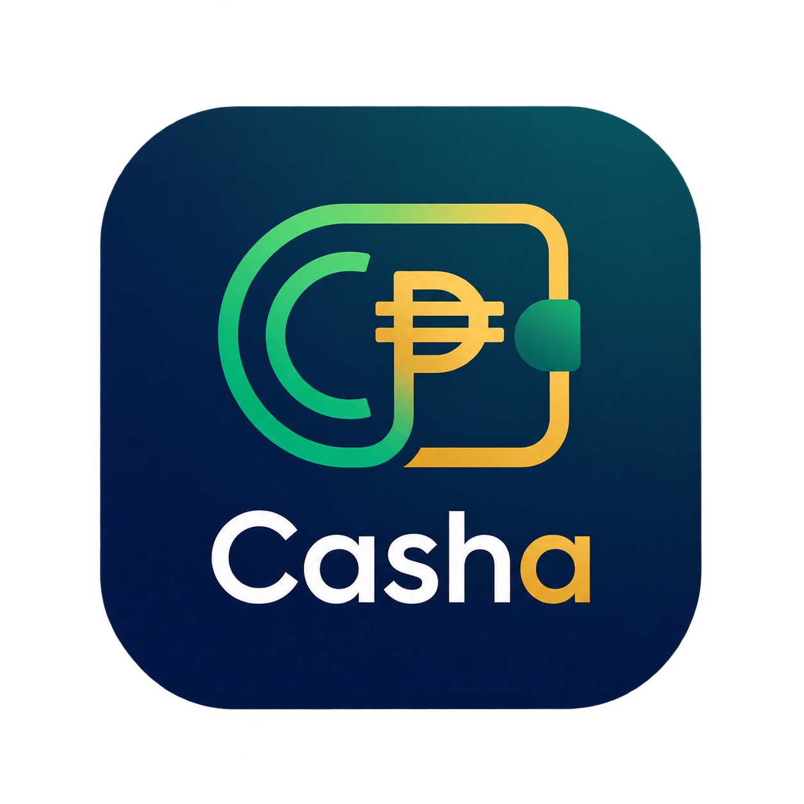
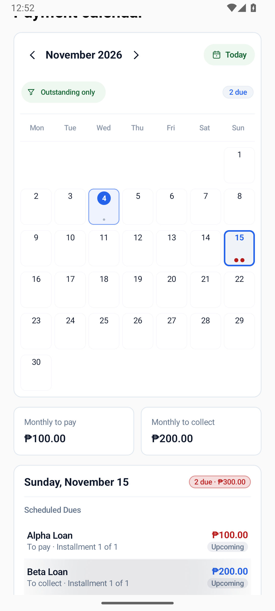
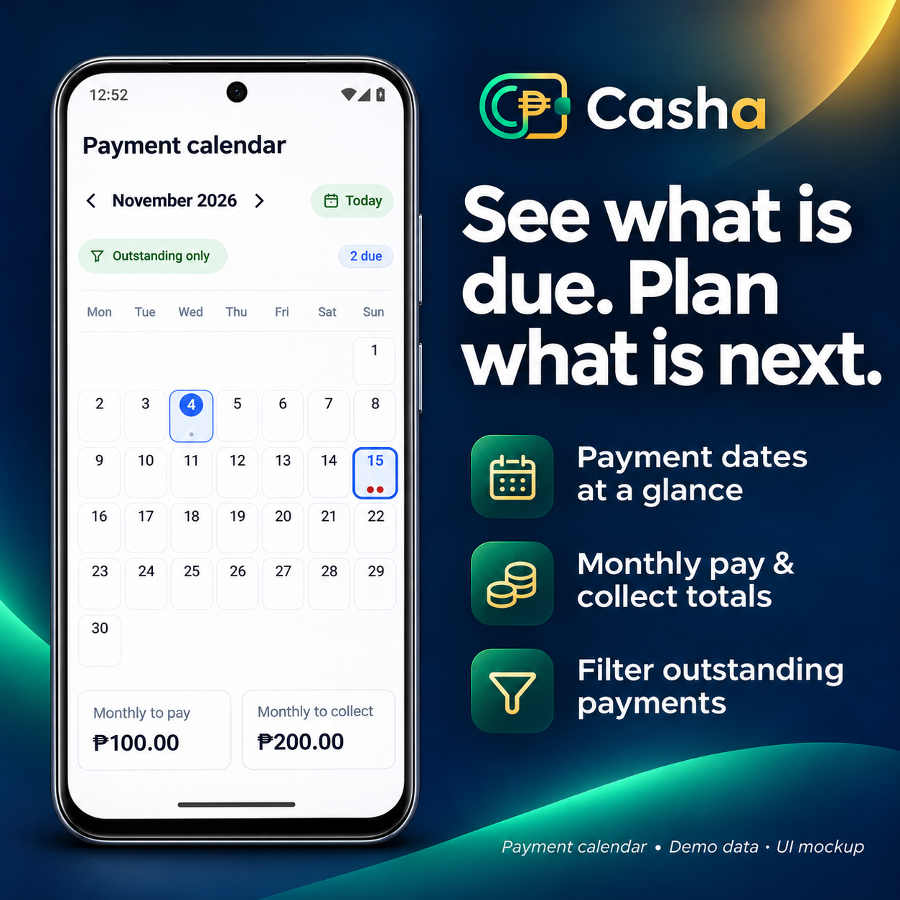

<p align="center">
  
</p>

<h1 align="center">Casha</h1>
<p align="center">An Android personal finance app for everyday money decisions.</p>
<p align="center">
  <a href="https://github.com/Jhtin/Casha/actions/workflows/checks.yml"></a>
  
  
  
</p>

[Download Android beta](#download-the-android-beta) · [Features](#explore-the-app) · [Run locally](#run-locally) · [Validation](#validate)

Casha brings loan records, payment schedules, payday budgets, cash logging, and receipt review into one native Android app. Its Petot assistant adds optional conversational budgeting and transaction drafts in English or Taglish, with review before saving a proposed financial action.

Built by [Jhtin](https://github.com/Jhtin). This repository showcases the **v2.12.1 / Build 38** source and product design. It is a personal project, not a published Play Store release or a financial-advice service.

## Download the Android beta

**[Download Casha v2.12.1 — Build 38 APK](https://github.com/Jhtin/Casha/releases/download/v2.12.1-beta.1/Casha-v2.12.1-build38.apk)**

Android **8.0 or newer** is required. Read the [release notes and checksums](https://github.com/Jhtin/Casha/releases/tag/v2.12.1-beta.1) and [installation guide](docs/INSTALLATION.md). This is a signed public beta for direct installation, with the app's Firebase configuration included in the APK. Optional AI requires your own Gemini key and consent.

**Existing personal/debug installations:** this beta uses the established public release certificate and cannot update an app signed with a different key. Keep your current app and data; use a separate test device or emulator if Android reports a signing conflict. Do not uninstall your personal copy to resolve that conflict.

## Explore the app

| Area | What it does |
| --- | --- |
| Loans & payments | Separate **I Owe** and **Owed to Me** ledgers, installment schedules, partial payments, payment history, and reversals. |
| Payday planning | Available cash, planned reserves, safe-to-spend estimates, daily allowance, and cash entries across accounts. |
| Payment calendar | Monthly due dates, scheduled payment details, outstanding-payment filters, and pay/collect totals. |
| Petot | Optional Gemini-powered budgeting questions and transaction drafts, English/Taglish support, and an expressive coin companion. |
| Receipt review | On-device text recognition with manual review of extracted information before saving. |
| Personal controls | Optional app lock, reminder settings, widget privacy, companion motion/sound controls, and JSON export/restore. |
| Cloud ledger | Opt-in Firebase Authentication and Firestore synchronization for loan/payment records with account separation and conflict review. |

### App screenshot



### Product concept gallery

The following graphics are AI-generated promotional mockups. They illustrate the product concept; they are not pixel-exact screenshots of Build 38.

### Petot in the interface


### Planning and payment dates

| Payday planning | Payment calendar |
| --- | --- |
|  |  |

The showcase graphics above are **AI-generated promotional UI mockups**, based on project layouts and demo content; they are not pixel-exact screenshots of Build 38. For a real saved sample capture, see the [calendar demo screenshot](docs/images/calendar-demo-screenshot.png). All amounts in the showcase are illustrative.

## Built with

- **Kotlin + Jetpack Compose / Material 3** for the Android interface.
- **Firebase Authentication + Cloud Firestore** for optional account-based loan synchronization.
- **ML Kit** for on-device receipt text recognition.
- **Gemini** for optional, explicitly requested assistant responses and proposals.
- **Android WorkManager, notifications, and widgets** for supporting device features.
- **JUnit, Compose UI tests, and Firebase emulator tests** for validation.

The Android source is organized under `app/src/main/java/com/example/casha/`: `data/` contains records, persistence, synchronization and assistant integration; `ui/` contains screens and reusable components; `reminders/` and `widget/` contain device integrations. Firestore rules and their tests live in `firebase/`.

## Run locally

1. Clone this repository and open it in Android Studio with a **JDK 25** Gradle runtime. Install **Android SDK platform 37** (the SDK package is `platforms;android-37.0`). The app targets API 36 and supports API 26+.
2. For a local UI build, copy `app/google-services.json.example` to `app/google-services.json`. This contains **synthetic demo identifiers**, not working cloud credentials. Google sign-in and live cloud access require your own Firebase setup.
3. Let Android Studio create `local.properties`, or set `ANDROID_HOME` to your SDK location.
4. Build and run the `app` module on a dedicated emulator or test device.

```sh
cp app/google-services.json.example app/google-services.json
./gradlew testDebugUnitTest assembleDebug --max-workers=2
```

On Windows use `Copy-Item app/google-services.json.example app/google-services.json` and `./gradlew.bat` instead.

To enable cloud features, register **your own** Firebase Android app with package `com.example.casha`, enable Google Authentication and Firestore, register your debug signing certificate, and replace the local demo configuration with the file downloaded from your project. Review the [cloud setup](firebase/README.md) before deploying rules. Never commit your local configuration or signing keys.

Petot's AI features additionally require a Gemini API key entered in the app's Settings and the app's consent flow. Manual finance tools and local receipt OCR work without that key. The app cannot determine the billing status of a supplied key; provider charges and quotas depend on the account used.

Debug builds use Android's standard debug signing key unless a private `app/debug.keystore` is supplied locally. They are not compatible updates for an existing installation signed with another key. Release builds are unsigned unless production signing is deliberately configured; see [development](docs/DEVELOPMENT.md).

## Validate

```sh
./gradlew testDebugUnitTest assembleDebug assembleDebugAndroidTest lintDebug --max-workers=2
cd firebase
npm ci
npm test
```

Firebase tests use only the synthetic `demo-casha` project and local emulators. Android instrumented tests require an isolated emulator; see [testing and development](docs/DEVELOPMENT.md). CI performs unit tests, debug/test compilation, Android lint, and Firestore rules tests. It does not exercise physical-device behavior or live AI/cloud services.

## Data and project scope

Cloud synchronization covers loans and payment histories. Budgets, receipts, local preferences, and related device records have their own local storage boundaries. JSON exports do not bundle receipt image files. Keep backups and original receipts separately.

Assistant requests send the entered text and selected financial context to the configured provider after consent. Receipt text recognition is performed on the device. Always review proposed changes before saving. Read the in-app privacy policy for details.

This repository includes a signed public beta APK and its source; it is not an app-store publication. Live Google sign-in, AI responses, bank notification formats, and a range of physical devices require separate verification. Public source availability does not grant an open-source license; no license has been selected for this repository.
